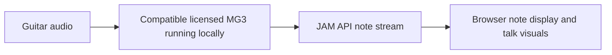

# MIDI Guitar 3: the standard guitar route and our next useful edge

Research date: 15 October 2026. Installed application: **3.0.74**.
Browser source baseline: `1b2dad3249477894b3e35fb0409b48e73f78bc22`.

This investigation began after the **Reverse engineer audio analysis** chat
(`01a14066-c2b3-7151-9b34-76e49199f6c8`) finished. It extends
[its recognizer analysis](mg3-deep-analysis.md) and the
[original handoff](guitar-research-handoff.md). This pass changes documentation
only; diagnostic inputs ran against the existing browser detector.

Implementation follow-up: [the current browser detector](guitar-polyphonic.md)
now includes continuous pitch proposals, weak-root fitting, octave filtering
within mixed chords and an independent analysis timer. The baseline results
below remain the historical measurements that motivated that change.

## What changes our decision

We found a more relevant route inside the executable: the module actually
constructed with the label **MIDI Guitar 3** contains a selectable recognition
front end, a multi-window `DFTModule`, and a `HighwayTrackerModule`. The earlier
four-window `MIDIGuitar32Core` is concretely connected to **MIDI Wind 3** and a
**HexTracker2Module**. Its mathematics remains useful, but it should not be
presented as the ordinary guitar module's established default algorithm.

The strongest independently implementable lead is **continuous fundamental
hypotheses supported by several partials, followed by competition between
possible voices**. Our browser implementation already fits competing harmonic
templates, but first excludes candidates without a sufficiently strong
fundamental and tests harmonics against a fixed semitone grid. Controlled
diagnostics below expose the consequences. Better candidate proposals and
better evidence for an extra voice are more targeted next steps than adding
another global sensitivity slider.

There is also a potentially much shorter route to high-quality talk visuals:
Jam Origin documents an official WebSocket note API for **3.0.80 and later**.
That could feed the browser directly without converting through MIDI. The
installed 3.0.74 is below that documented version, and this integration has
not been tested. See [the integration option](#the-official-browser-connection).

We recovered specific operations and routing, not the complete engine. None of
these findings proves MG3 accuracy on our fixtures, identifies the current live
preset, or promises perfect note recognition from a mono guitar signal.

## Evidence and binary identity

**Observed** means executable bytes, constructor strings, RTTI, calls, vtable
entries, or browser diagnostic output. **Derived** means a mathematical reading
of those observations. **Proposed** means an experiment for our own detector.

| Item | Pinned value |
| --- | --- |
| Installed executable | `/Applications/MIDI Guitar 3.app/Contents/MacOS/MIDI Guitar 3` |
| Universal SHA-256 | `9dd630985e0d66d4ab957df9acf9122cf60d48b55c456c88f1941d339f008a34` |
| ARM64 SHA-256 | `0d2362d7760523f4169d9bbf6cb4ca03b675fda0a36a64b558bbae53129d672d` |
| Ghidra | 12.1.4 PUBLIC, `AARCH64:LE:64:AppleSilicon` |
| Local follow-up evidence | `/Users/tim.benniks/.codex/analyses/mg3-edge-2026-10-15/` |

Addresses are **unslid ARM64 virtual addresses**, not file offsets or addresses
that remain valid after updating the app. Type names are retained RTTI names;
function descriptions below are our interpretations.

### Decompiler limits that mattered

Several large functions begin with an indirect call to `___chkstk_darwin`.
Ghidra initially treats incoming registers as clobbered and produces misleading
parameters and return values. The unmodeled Highway decompilation timed out.

For a second export, a copied project was opened with `-readOnly`. Four verified
stack-probe call instructions were temporarily represented as NOPs in that
analysis database: `0x1001ac4ac`, `0x1001dfd74`, `0x1001dcbf0`, and
`0x1001dc254`. The original instructions were `BLR x16`, reached through the
`___chkstk_darwin` import at `0x10109c210`. We also supplied a three-pointer
signature for Highway and corrected standard math import signatures.

This is an **analysis model**, not a patch to the installed application or the
thin executable. The log confirms that Ghidra discarded the database changes.
Original instruction exports remain beside modeled exports. SIMD types,
floating-point aggregate returns, and many structure fields are still
incomplete; a successful decompilation does not make every C-like expression
correct. One consequential return-value correction appears below.

## 1. Establishing which engine belongs to which module

The following chains combine constructor labels, RTTI, and virtual dispatch.
They are stronger evidence than finding a promising class name in strings.

| Constructed module | Static evidence | Consequence |
| --- | --- | --- |
| **MIDI Guitar 3** | Constructor `0x10030b034`; processor vtable `0x1010b5f40` identifies `MIDIGuitar3Processor`; its module vtable `0x1010a2888` identifies `MIDIGuitar2Module` | The legacy internal “2” name does not identify a separate installed MG2 product. Follow its actual children and callbacks. |
| **MIDI Guitar 3.1** | Constructor `0x10030bf78`; module vtable `0x1010b6300`, slot `+0xc0` → `0x1001c9330` → core `0x1001c9628` | This anchors the earlier resonator-bank/FFT research to a named module. |
| **MIDI Wind 3** | Constructor `0x10030c4b4`; module vtable `0x1010b66a0`, slot `+0x130` → `0x1001de04c` → core `0x1001d1ef0` | A concrete consumer of the earlier 3.2 four-window engine. |
| **HexTracker2Module** | RTTI at vtable `0x1010b73a0`; slot `+0x130` → `0x100330ee8`; callback iterates six core objects | Another concrete 3.2 consumer, with separate channel inputs. This does not demonstrate the same performance on a mono mix. |

The standard guitar constructor creates these objects:

| Component | Evidence |
| --- | --- |
| DFT analyzer | Constructor `0x1001a1330`; vtable `0x1010a3278`; stored at guitar-module offset `+0x5d4a8` |
| Highway tracker | Vtable `0x1010a3508`; callback `0x1001ac474`; stored at `+0x5d4d0` |
| Retrigger tracker subobject | `RetriggerTrackerModule2`, vtable `0x1010a3e08`, callback `0x1001dfd3c`, inside Highway at `+0x5010` |
| Mono recognition front end | Constructor `0x10014e94c`; vtable `0x1010a2b50`; processing slot `+0x10` → `0x100185c88` |
| Polyphonic recognition front end | Constructor `0x10014ecfc`; vtable `0x1010a2d28` identifies `GuitarRecognitionProcessor7`; processing slot `+0x10` → `0x10014fe08` |

The retrigger object's construction is established; this pass does not fully
trace its invocation and event decisions. Its class name alone is insufficient
to infer the attack algorithm.

### Selection is conditional

The main wrapper `0x10014bcf4` configures the module via `0x10014e0f8`, then
uses the block dispatcher `0x100136970`. Callback `0x10014c784`, at module
vtable slot `+0x138`, processes a 256-sample branch. The separate callback
`0x10014c234` handles 128-sample preparation; it is not evidence that the full
recognizer decides a note every 128 samples.

Configuration maps a normalized control through `round(2 * value)` to internal
modes 1, 2, or 3. For generation values 10/20 it constructs, respectively, the
mono front end, the polyphonic front end, or both. Generation 30 constructs
the mono-named front end and can pass its output through Highway. A mono-named
component is therefore not proof that the entire pipeline is monophonic.

In the callback, DFT runs when the rounded control index `round(2 * value)`
is greater than 1 (the selection mapped to internal mode 3), or generation
is 30. Highway dispatch is also conditional; one front-end path explicitly
checks generation 30 before invoking it. Other branches exist, including an
alternative producer at module offset `+0x5d4e0`. The result reaches the shared
voice adapter `0x10014de5c`.

The constructor's two integers at `0x1008a15d8` are **10 and 0**. Do not claim
generation 30 is the live default merely because this is a product named MG3.
This analysis did not follow all subsequent preset writes. Configuration also
clamps a lowest tuning value to MIDI 36–40; this is not proof that the entire
recognizer supports only that range.

## 2. The standard guitar route has its own multi-window analyzer

**Observed:** `DFTModule` configuration at `0x1001a0094` constructs eleven
4096-point FFT analyzer records with the following window lengths in samples:

```text
719, 855, 1018, 1212, 1442, 1716, 2042, 2430, 2892, 3442, 4096
```

These are fixed sample counts in this setup function. The three selector
indices initialize to **2, 6, 10**, selecting **1018, 2042, 4096** samples.
The pair 2/6 comes from raw data at `0x1008a0150`; 10 is an immediate store.
Configuration constructs two additional analyzer records, so eleven supported
lengths must not be confused with eleven transforms executed per block.

**Observed:** callback `0x1001a09b8` shifts a 4096-sample history by 256 samples,
iterates the eleven records, and enters the main transform branch only for
the three selected indices. It multiplies samples by the window, zero-pads,
uses Accelerate real FFT operations, calculates magnitudes, and applies a
`1 / windowLength` normalization. An additional transform branch exists for
the third selected window. Exact alignment and the purpose of the additional
records need further work; “exactly three FFTs per block” would be premature.

Working state is at `DFTModule + 0x5008`. The output descriptor referenced at
`DFTModule + 0x5010` receives three spectrum pointers, at working-state offsets
`+0x1082d0`, `+0x1042d0`, and `+0x1002d0`. Highway reads that descriptor through
its DFTModule pointer at `Highway + 0x5008`. This connects the spectrum buffers
to the tracker, rather than merely showing that FFT code exists in the app.

### Window shape: Kaiser, beta 4

**Derived from the actual setup loop:** the eleven main windows follow

```text
w[n] = I0(4 * sqrt(1 - (2*n/(L-1) - 1)^2)) / I0(4)
I0(z) = sum over k >= 0 of (z*z/4)^k / (k!)^2
```

The implementation evaluates the series iteratively and stops when its next
term falls below approximately `1e-6` of the accumulated sum. The parameter 4
appears both in the numerator argument and denominator series. This identifies
the symmetric **Kaiser window with beta 4**, using the standard
[Kaiser definition](https://docs.scipy.org/doc/scipy/reference/generated/scipy.signal.windows.kaiser.html).

This is a different window from the earlier 3.2 Welch path and our browser
`AnalyserNode`'s Blackman window. The latter is specified by
[Web Audio](https://www.w3.org/TR/webaudio-1.0/#fft-windowing-and-smoothing-over-time).
It does not follow that replacing Blackman with Kaiser will improve accuracy;
window shape, peak thresholds, templates, and normalization interact.

| Initialized selected length | Span at an illustrative 48 kHz |
| --- | ---: |
| 1018 samples | 21.21 ms |
| 2042 samples | 42.54 ms |
| 4096 samples | 85.33 ms |
| 256-sample advance | 5.33 ms |

These are window spans and a block duration, **not measured onset latency**.
Selectors may be changed elsewhere, and execution depends on the chosen route.
Zero-padding gives a common frequency grid; it does not turn a short window
into a long observation with the same resolving power.

## 3. A directly relevant harmonic hypothesis pattern

Highway's callback `0x1001ac474` obtains peak lists from the selected spectra.
Helper `0x1001b4a98` checks local maxima and uses a quadratic fit in
log-magnitude to refine peak position. Our browser already uses a related
three-bin peak interpolation; that alone is not the missing feature.

The more useful operation is helper **`0x1001b4bfc`**. For each peak frequency
`p`, it considers five potential relationships:

```text
candidate fundamental f = p, p/2, p/3, p/4, p/5
for another peak q:
    h = round(q/f)
    if 1 <= h <= 7:
        discrepancy = max(q/(h*f), (h*f)/q)
        retain the smallest discrepancy for this hypothesis
```

The routine skips an identical frequency/amplitude record and stores five
compatibility values in a 0x30-byte record. A value close to 1 means that
another peak lies close to an integer multiple of the proposed fundamental.
This does **not** count all supporting partials or itself accept a note.

Highway calls it for three peak lists and passes the resulting information
into candidate evaluation at `0x1001b4f20`. This establishes that the standard
route explicitly considers a detected peak as a higher harmonic, rather than
requiring every candidate to originate at a detected fundamental peak.

**Proposed transfer:** derive continuous-frequency candidates from several
peaks divided by small harmonic numbers; cluster nearby proposals in cents;
then require support across distinct partials and fit competing candidates
jointly. Preserve a plausible candidate even when its first partial is weak.
The cluster rule and acceptance score would be our design, not recovered MG3
code. This evidence does not prove the complete app accepts every missing-root
case or identify all its rejection rules.

## 4. Useful additions to the earlier 3.2 analysis

These findings describe the **3.2 route**, whose concrete Wind/Hex consumers
are identified above. They must not be silently merged into the standard
DFT/Highway implementation.

### Score with resolution appropriate to the proposed pitch

Helper `0x1001dc230` switches the spectrum used for harmonic/inharmonic scoring:

| Candidate frequency | Spectrum offset in core | Window duration basis |
| --- | --- | --- |
| `f < 2 * fLow` | `+0x5d5c8` | 3 periods of the configured low boundary |
| `2 * fLow <= f < 4 * fLow` | `+0x5c5c8` | 2 periods |
| `f >= 4 * fLow` | `+0x5b5c8` | 1.5 periods |

The longest, six-period spectrum at `+0x5e5c8` serves other checks. For the
earlier illustrative lower-note-40 configuration at 48 kHz, the boundary is
about 80.0609 Hz, lengths are 1799/1199/899 samples for the table above, and
switches occur near 160.12 and 320.24 Hz. These are configuration-derived
examples, not observed live settings.

**Proposed transfer:** short windows can provide evidence for higher notes and
attacks while long windows support lower notes. Requiring every note to be
equally clear in every window would discard the purpose of different lengths.

### Compare how much spectral structure one or two candidates explain

Helper `0x1001dc63c` fills a mask on the longest spectrum. For harmonic orders
2 through 11, it caps the rounded-bin magnitude with approximately

```text
2 * median(S((h-1)*f), S(h*f), S((h+1)*f))
```

Here the three `S` values use linear interpolation; the quantity being capped
uses the rounded harmonic bin. The fundamental is not subject to this cap.
The same routine can add a second candidate, combining mask values by **max**,
so shared harmonic bins are not simply counted twice.

The returned ratio is the sum of mask values divided by the sum of **local
spectral maxima**, with a small denominator floor. It is not an all-bin energy
fraction or a calibrated probability; do not assume it is bounded by 1.
The median interpretation of the decompiled comparison branch was checked
on 512 finite, nonnegative triples, including tied values. This validates that
branch simplification, not full recognizer behavior or NaN handling.

**Proposed transfer:** an additional voice should explain evidence the current
voices cannot explain. Compare a pair against its best single-voice alternative
with a complexity penalty. A brighter single note must remain an alternative
to a supposed octave pair. The binary's thresholds should not be copied into
our differently normalized spectra.

### A harmonic chain, and an important return-value correction

Helper `0x1001dcbc4`, reached through `0x1001dc038`, builds running scores and
backpointers for a sequence of peaks separated by approximately the candidate
fundamental. Its predecessor search allows roughly 0.97–1.03 times that spacing
plus integer rounding/margins. This is a max-score dynamic-programming chain,
followed by a backtrace; it can accumulate support from later harmonics.

The code also calculates a weighted fundamental estimate using square-root
magnitude weights and harmonic-index normalization. **It does not return that
estimate as the refined pitch.** At `0x1001dcf5c`, `mov v0.16B,v8.16B` restores
the original candidate into the first floating return register. The calculated
mean participates in a validity check, and the second floating return register
contains a guarded score. This is why the decompiler's apparent return type
must be checked against the machine instructions.

This supports testing a tolerant harmonic-spacing score. It does not establish
that the complete 3.2 route recognizes every signal with an absent fundamental.

## 5. Measured weaknesses in our existing browser detector

These are new **diagnostic observations**, not application edits. They use the
existing [waveform fixture](../tests/guitar-signal.mjs), which synthesizes a sum
of sinusoids and independently computes its Blackman-windowed FFT, and the
unchanged [detector](../shared/stage/guitar-poly.ts).

Common settings: 48 kHz; 4096 samples; amplitude 0.08; ten partials with
`1 / harmonic^1.3` falloff; deterministic noise amplitude 0.00001; twelve
observations at `frame / 30` seconds; default gate −65 dB and octave ratio 0.65.
“Strong even partials” uses gains `[1,2,1,1.6,1,1.2,1,1,1,1]` on top of that
falloff. Omitted gains equal 1. Only the last row changes detector calibration.
Results below remain unchanged throughout frames 2–11, indexed from zero.

| Synthesized input | Detected notes | Interpretation |
| --- | --- | --- |
| E3 | E3 | Control |
| E3, fundamental removed | E4, B4 | Missing real pitch, two harmonic substitutions |
| E3, fundamental reduced to 5% | E3, E4, B4 | Root survives, harmonic false positives remain |
| E3, +15 cents | E3 | Small offset survives |
| E3, +25 cents | None | Ordinary continuous pitch falls between supported hypotheses |
| E2, +25 cents | E2 | The same cents offset behaves differently at lower frequency |
| E3, strong even partials | E3 | Existing isolated-note octave filter works here |
| E3 + G3, strong even partials | E3, G3, E4, G4 | Mixed chord bypasses that protection |
| Actual E3 + E4 | E3, E4 | Control: real octave pairs must remain possible |
| E3, +15 cents, detector calibrated +15 cents | E3 | Control for global tuning compensation |

Raw results, per-frame output, settings, and source hashes are saved locally as
`browser-diagnostics.json` in the follow-up evidence directory. MIDI numbers
used here are E2=40, E3=52, G3=55, E4=64, G4=67, B4=71.

These are synthetic, stationary signals. They do not measure a real pickup,
pluck transient, recording interface, browser scheduling, or MG3 itself.

### Why these failures are actionable

The browser's candidate eligibility requires a fundamental above
`max(noise * 4, peak * 0.025)` and at least two supporting harmonics. Removing
the root can eliminate the correct candidate before the joint fit gets a
chance to explain the upper partials.

Harmonic support is tested within **0.45 FFT bins** of a fixed, globally tuned
semitone template. At 48 kHz/4096 that is about **5.273 Hz per harmonic**. A
fixed Hz allowance is a smaller cents allowance at higher frequencies, and
fundamental detuning is multiplied at each harmonic. This is consistent with
the different +25-cent outcomes. Per-note continuous refinement is a better
first experiment than indiscriminately widening the gate; the latter also
admits unrelated nearby peaks. Global calibration cannot follow individual
bends or independently detuned strings.

The fit uses three generic harmonic falloffs and a sparse nonnegative
coordinate-descent solver. The current octave ratio filter only runs when
**every surviving candidate belongs to the same pitch class**. A second pitch
class disables it. That explains why a single bright E and a bright E/G chord
receive different protection. Applying a larger global ratio to all chords
would risk suppressing genuine quieter notes.

There is a separate timing limitation: the stage integration calls the fit
from its display update, capped at about 30 Hz. The spectrum spans about 85 ms
at 48 kHz, and note acceptance takes two observations. These are distinct
sources of delay; simply adding their nominal durations is not an end-to-end
latency measurement.

## 6. A small original detector worth testing

The first experiment should retain our existing browser implementation and
change the earliest decision that demonstrably prevents the right answer.
This is a proposal, not work performed in this documentation pass.

1. **Propose pitches continuously.** Refine peaks, vote for fundamentals at
   small integer submultiples, group nearby proposals in cents, and require
   independent partial support. Let weak-root candidates reach the fit.
   Test missing-root and +25-cent cases before adding architecture.
2. **Demand evidence for an extra voice.** Keep joint competition between
   candidates. Compare a second note with plausible changes in the first
   note's harmonic balance. Evaluate the bright E/G failure alongside real
   octave pairs at unequal levels. Do not make the synthetic failure disappear
   merely by disallowing octave playing.
3. **Add temporal evidence where it helps.** Distinguish a new attack from
   changing sustain timbre, track continuous frequency, and retain stable
   voice identities. Use per-voice attack/release evidence before assuming a
   shared rise in loudness means every held note was struck again.
4. **Then test aligned short/long analysis on the audio clock.** A small
   AudioWorklet can collect samples independently of drawing and emit analysis
   results at a controlled cadence. Begin with two useful lengths and add a
   third only if recordings justify it. This capability is supported by the
   [AudioWorklet processing model](https://www.w3.org/TR/webaudio-1.0/#AudioWorkletProcessor).

Keep the internal result as voice identity, frequency, detection score,
attack/release state, and sample timestamp. Pitch labels and game lanes can
consume those directly; MIDI is an optional output adapter. An uncalibrated
score should not be advertised as a probability of correctness.

There is no evidence here that a neural model, a large dictionary, or a native
rewrite is required. Conversely, moving the same decisions to native code
would not solve their ambiguities. Consider native processing for a measured
performance or routing need, not as an automatic accuracy upgrade.

### What “perfect” cannot mean for a mono input

A lower note with freely varying even harmonics can produce the same steady
spectral observations as that lower note plus an octave. No rule using only
those observations can always distinguish the two. Extra windows on the same
stationary signal do not create the missing information. Attack history,
phase behavior, realistic timbre constraints, and musical context can reduce
uncertainty. They cannot justify a universal guarantee.

Likewise, a pitch alone does not identify which physical string/fret produced
it. For the talk, pitch-class lanes and reliable attacks are a more attainable
target than exact fingering. An expected chord or song sequence can be an
optional prior, but the visual should not claim a note was heard merely because
the score expected it.

Before selecting thresholds, record an annotated clean-DI set with single
notes, bright/dark picking, muted strings, bends, missing/weak roots, unequal
octave pairs, mixed chords, rapid restrikes, and silence. Hold out recordings
when tuning. Report false extra notes, missed notes, onset delay, duplicate
attacks, and release behavior separately. Measure microphone/interface-to-screen
latency under the actual presentation load. MG3 can be a comparison, not the
ground-truth labeler.

## The official browser connection

Jam Origin's developer page documents a **JAM API from MG3 3.0.80 onward**,
including an external WebSocket interface aimed at browser/native visualizations
and musical tools. The API is described as free for personal and commercial
projects. That statement concerns the API, not a standalone redistribution of
the MG3 engine. [Official JAM API documentation](https://jam.live/developers/)

The WebSocket documentation describes notes sent by Lua/Html modules through
localhost port 8080. The stream carries timing, played-note and processed-note
groups, and per-note identity, age, string, pitch, bend, pressure, and brightness.
The format is explicitly described as immature during beta.
[Official WebSocket documentation](https://jam.live/developers/websocket/)

For our talk, this is the strongest **integration candidate** to try before
building a native bridge or reconstructing the entire detector:



It preserves an in-browser interface and can avoid the MIDI transport step,
but recognition still depends on the native application. It does not meet the
separate goal of a self-contained browser detector.

The installed version is **3.0.74**, below the documented API requirement. We
have not established that a suitable build is available to this installation,
upgraded it, enabled modules, opened a socket, or validated the stream. A later
integration experiment must verify those prerequisites and the exact browser
and site origin's ability to connect to the local service. Keep any parser
versioned and handle disconnects explicitly because the documented format may
change. No existing MIDI guitar input or product settings were restored here.

## Evidence map and reproduction

All binary-derived exports and scratch verification programs remain outside
the repository. This document records observations and proposals, not copied
engine source. The original study and the other chat's export remain intact.

Follow-up directory:

```text
/Users/tim.benniks/.codex/analyses/mg3-edge-2026-10-15/
  raw/                 Initial focused exports and caller/string leads
  routes/              Constructors, dispatch, and vtable evidence
  standard/            DFT setup/callback and candidate helpers
  modeled/             Seven exports with the stated stack-probe analysis model
  scripts/             EdgeMG3.java and ModelEdgeMG3.java
  *-targets.txt        Focused address sets; also targets.txt
  *.log                Ghidra export and discarded-change confirmations
  binary-facts.json    Hash, selected RTTI/vtable entries, constants
  browser-diagnostics.json
  median-branch-check.c, median-branch-check.txt
```

| Claim to revisit | Primary function / evidence |
| --- | --- |
| Standard module owns DFT/Highway | `0x10030b034`, `routes/` and `standard/` |
| Conditional frontend and tracker selection | `0x10014e0f8`, `0x10014c784` |
| DFT lengths, selectors, Kaiser series | `0x1001a0094`, raw bytes at `0x1008a0150` |
| Selected spectra and output descriptor | `0x1001a09b8` |
| Highway consumes those spectra and candidate helpers | `0x1001ac474`, `modeled/` |
| Peak interpolation and p/h compatibility | `0x1001b4a98`, `0x1001b4bfc`, `0x1001b4f20` |
| 3.2 pitch-conditioned spectrum selection | `0x1001dc230` |
| Single/pair coverage and median cap | `0x1001dc63c`, median branch check |
| Harmonic chain return correction | `0x1001dcbc4`, especially instruction `0x1001dcf5c` |
| Browser observations | `browser-diagnostics.json`, including source hashes |

The existing [binary research utility](../scripts/research/mg3/research_mg3.py)
provides a hash-checked Mach-O virtual-address reader. A vtable's RTTI pointer
is the 64-bit value at `vtable - 8`; its name pointer is at `typeinfo + 8`.
Read only the relevant virtual slots, rather than interpreting adjacent data
as a table with a guessed length.

To repeat the follow-up export, copy the original `MG3Study.gpr` and associated
`MG3Study.rep` into a fresh project directory outside the repository. Use the
original bundled JDK 21 and Ghidra from
`/Users/tim.benniks/.codex/analyses/mg3-2026-10-15/tools/`, and invoke
`analyzeHeadless` with:

```text
<copied-project-directory> MG3Study
-process MG3-arm64 -noanalysis -readOnly
-scriptPath /Users/tim.benniks/.codex/analyses/mg3-edge-2026-10-15/scripts
-postScript EdgeMG3.java <target-file> <new-output-directory>
```

Use `targets.txt`, `route-targets.txt`, or `standard-targets.txt` for the
corresponding pass. Use `ModelEdgeMG3.java` and `model-targets.txt` only for the
explicitly modeled pass; preserve an unmodeled instruction export for comparison.
Require the pinned SHA-256, a successful export count, and the log's discarded
changes confirmation. Do not execute the decompiled output as a recovered engine.

To reproduce the browser diagnostics without editing application files, import
`GuitarPolyDetector` and `spectrum` in a Node session with TypeScript stripping,
construct a fresh detector for each row, and feed twelve spectra using the
settings and inputs in section 5. The last row supplies 15 as the detector
constructor's third argument. Compare frames 2–11, rather than only checking
one favorable frame. The saved JSON contains all exact case options.

Remaining useful static targets are `0x1001b4f20` and its helper `0x1001b6370`
for downstream candidate acceptance, plus the Highway/retrigger interface.
Dynamic tracing would be needed to establish the live preset's exact route.
Neither is a prerequisite for testing the independent browser improvements
or evaluating the documented integration option.
